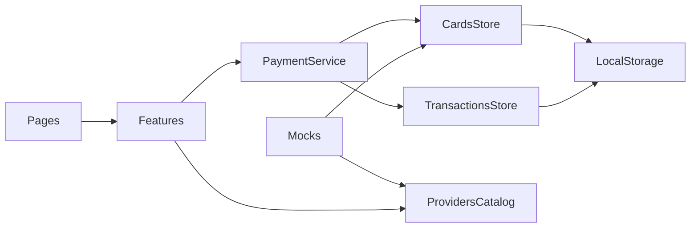

# Онлайн-банк (в стиле PayMe, Click, Uzum Bank)

## Стек
- React 18, Vite, TypeScript, Tailwind CSS
- `react-router-dom` для маршрутизации
- `zustand` с middleware `persist` для состояния и сохранения в localStorage
- `react-hook-form` и `zod` для форм и валидации
- `i18next` и `react-i18next` для интерфейса на ru, uz и en
- `lucide-react` для иконок

## Функциональность
- **Главная**: общий баланс (можно скрыть или показать), карусель карт, быстрые действия (оплатить, перевести, пополнить телефон), последние операции.
- **Карты**: список карт и добавление новой. Номер проверяется по алгоритму Луна, платёжная система (Uzcard 8600, Humo 9860, Visa 4, Mastercard 5) определяется автоматически, срок действия и маска вводятся в форме. Есть мок-подтверждение по SMS (код `123456`). Карту можно сделать основной, заблокировать или удалить.
- **Платежи**: категории (мобильная связь, интернет, коммунальные услуги, ТВ, транспорт, налоги, образование, игры), а внутри них поставщики (Beeline, Ucell, Mobiuz, Uzmobile, Uztelecom, Hududgaz, Elektr, Suvsoz и другие). Поля формы у каждого поставщика свои (телефон, лицевой счёт). Платёж проходит по шагам: выбор карты, сумма с учётом комиссии, подтверждение, чек.
- **Переводы**: с карты на карту по номеру (мок с определением получателя).
- **История**: список операций с фильтрами по типу и дате, а также детальный чек.
- **Профиль**: переключение языка (ru, uz, en) и сброс демо-данных.
- Суммы показываются в UZS через `Intl.NumberFormat`. Оплата имитирует сетевую задержку и может завершиться ошибкой, например «Недостаточно средств» или «Карта заблокирована».

## Архитектура



- Состояние хранится в сторах, а вся бизнес-логика списания и создания транзакции живёт в `paymentService` (принцип единственной ответственности). Компоненты к сторам за этим напрямую не обращаются.
- Каталог поставщиков описан декларативно: поля формы, комиссия, минимальная и максимальная сумма. Новый поставщик добавляется без изменения кода (принцип открытости/закрытости).

## Структура `src/`
- `app/`: `App.tsx`, `router.tsx`, `Layout.tsx` (нижняя навигация на мобильных, сайдбар на десктопе)
- `shared/ui/`: `Button`, `Input`, `Modal`, `BottomSheet`, `Amount`, `EmptyState`
- `shared/lib/`: `formatMoney.ts`, `luhn.ts`, `cardUtils.ts` (маска, определение платёжной системы), `delay.ts`, `id.ts`
- `shared/i18n/`: `index.ts`, `locales/ru.json`, `locales/uz.json`, `locales/en.json`
- `entities/card/`: `types.ts`, `store.ts`, `CardView.tsx`
- `entities/transaction/`: `types.ts`, `store.ts`, `TransactionItem.tsx`
- `entities/provider/`: `types.ts`, `catalog.ts`
- `mocks/`: `cards.ts`, `transactions.ts`, `user.ts`
- `services/paymentService.ts`: `pay()` и `transfer()` с валидацией баланса и статуса карты
- `features/`: `add-card/`, `pay-provider/`, `transfer/`, `balance-toggle/`
- `pages/`: `HomePage`, `CardsPage`, `PaymentsPage`, `ProviderPage`, `TransferPage`, `HistoryPage`, `ReceiptPage`, `ProfilePage`

## Ключевые типы (эскиз)

```ts
type CardBrand = 'uzcard' | 'humo' | 'visa' | 'mastercard';
interface Card { id: string; number: string; holder: string; expiry: string; brand: CardBrand; balance: number; isMain: boolean; isBlocked: boolean; color: string }
interface Transaction { id: string; type: 'payment' | 'transfer' | 'topup'; cardId: string; amount: number; fee: number; providerId?: string; details: Record<string, string>; status: 'success' | 'failed'; createdAt: string }
interface Provider { id: string; categoryId: string; name: string; logo: string; fields: ProviderField[]; feePercent: number; min: number; max: number }
```

## Дизайн
Мобильный подход в первую очередь: светлая тема, акцентный цвет в духе Click и Uzum (бирюзовый или фиолетовый), карты с градиентом и цветом своей платёжной системы, анимации в шагах платежа и экран чека с отметкой об успехе.